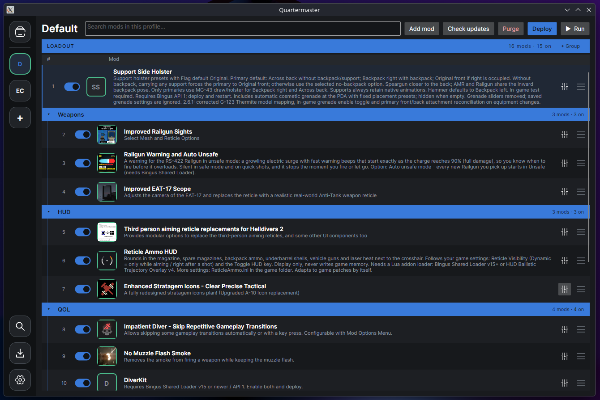

# Quartermaster



Quartermaster is a Helldivers 2 mod manager for organizing, updating, and deploying
mods. Search Nexus Mods from the app, track updates from Nexus Mods and GitHub,
and keep separate mod setups in profiles.

Disclaimer: This is actively in development and has yet to hit a stable v1.0 release. Expect the UI to change drastically, and features may be added or removed in subsequent versions.

- **Mod search:** browse Helldivers 2 Nexus Mods with thumbnails and open a
  result's download page from the app.

- **Mod updates:** check your library or a profile for updates, then install
  replacements without losing mod order, groups, or compatible option selections.

- **App updates:** enable **Allow automatic update** in Settings for background
  startup checks, or use **Check app updates**. Choose Update to install and restart,
  Skip to ignore that release at startup, or Cancel to decide later.

- **Profiles:** enable mods, select their options, organize them into collapsible
  groups with custom colors, and drag them to change load order. Set profile
  thumbnails from the sidebar, add descriptions and setup notes, and organize mods
  with searchable tags in mod details. Descriptions travel with duplicated and shared profiles.

- **Conflict inspection:** compare contributing mods and selected patch files for
  each overlapping resource, see which mod wins, and preview either load-priority direction.

- **Storage management:** inspect per-mod disk usage and selectively clean up
  unused previous versions, orphaned library content, and abandoned staging files.

- **Repatching:** repair outdated unit formats during deployment while keeping
  the original mod files. Choose automatic repatching, confirmation, or disable it.

- **Profile sharing:** export a profile and its mods in one ZIP, or import someone
  else's setup.

## Installation

Download a package from the [latest release](https://github.com/what386/quartermaster/releases/latest).

- **Windows x64:** run `Quartermaster-win-x64-setup.exe` to install for your user,
  with a Start menu shortcut and an optional desktop shortcut. Administrator
  permissions are not required. Uninstalling preserves your mod library and settings.
- **Portable Windows or Linux x64:** extract the matching `bundled.zip` archive
  and launch `Quartermaster.Gui.exe` or `Quartermaster.Gui`. Both archives include
  `icon.png`; the Windows executable also embeds the app icon.

All packages include the .NET runtime and support in-app updates.

## Getting started

First launch offers optional setup and a quick tour. Skip any step, and replay
them later from **Settings → Getting started → Setup and quick tour**.

1. Open **Settings** and select your Helldivers 2 installation, or use
   **Find Steam installs**. Configure provider credentials here if you want
   search and online updates.

2. Open **Library** and choose **Add mod** to import a ZIP, folder, or Nexus Mods
   or GitHub link. You can also drag ZIPs and folders into the app.

3. Click **+** in the sidebar to create a profile. Right-click mods in Library
   and choose **Add to** to add them to it. Dropping a mod into a profile imports
   it and adds it to that profile.

4. Select the mods and options you want, then click **Deploy** and **Run**.

Changes to a profile take effect when you deploy it. The deployed profile is
marked green; yellow mod outlines indicate a difference from what is deployed.

Use **Purge** to remove any deployed patches and have a vanilla game.

Use **Edit description** beneath the profile title to save notes for a loadout.
Choose **Inspect conflicts**, or right-click a mod and select it, to inspect
overlapping resources. The priority selector previews the winner without changing
the profile or deployed files; change the profile's load priority in Settings to
apply a different direction, then redeploy.

Right-click a profile to rename, duplicate, delete, or export it. Import a profile
ZIP through the create-profile dialog or by dropping it into the sidebar.

To migrate from a different mod manager, use **Settings → Imports → Import <manager> profiles**
This copies profiles, including mods, options, artwork, tags, mod pages, and tracking.
Import supports HD2Arsenal and Echelon. If youd like more managers supported, let me know.

## Search and updates

Use **Search** to find Helldivers 2 mods on Nexus Mods. Choose **Open download
page** to start an import. Quartermaster opens your browser and watches your
configured download folder; once the ZIP finishes downloading, it imports the mod.
Search results also show Nexus's virus-scan status for available ZIP files.

Nexus installs check the mod's requirements and offer to include missing
dependencies, including dependencies of dependencies. They go into the same
library or profile as the requested mod. Dependencies already in your library
can be added to a profile without downloading them again. External requirements
are listed for manual installation.

**Check updates** in Library checks all tracked mods. In a profile, it checks
that profile's mods. When updates are found, you can apply them from the prompt
or use **Update all** in the library header later. Individual mods also show an
**Update** button. The manual-check prompt follows separately.

GitHub release ZIPs download directly; Nexus Mods updates use your browser.

Updated mods keep their place in your profiles. After updates, you must redeploy.

The **Downloads** page shows pending and failed requests. You can attach a ZIP
manually if you already have it or download recognition misses it, retry a failed
request, or cancel it.

For mods without provider tracking, set a **Mod page** link in mod details.
You can also enter the page URL in the confirmation dialog when importing a local
ZIP or folder, including drag-and-drop imports.
**Check updates** offers to open a **Manual checks** list for these mods. You can
also open the list using the checklist icon beside Downloads in the sidebar.
Open a page to check for a newer ZIP; Quartermaster matches new downloads by name
and version, using token and fuzzy similarity for differing names. When versions
cannot be compared, a strong name match needs a newer creation or modification
timestamp. Parenthesized numbers such as `(2)` are not versions. Existing downloads
are ignored. Apparently lower versions show a warning with an **Import anyway**
option; uncertain matches need an explicit **Attach ZIP**. Updates keep the
mod's position, group, and compatible options in profiles. **Mark checked** ends
the watch when there is no update. Downloaded ZIPs remain in your browser's folder.

## Provider credentials

Configure credentials in **Settings**, then click **Save**.

- **Nexus Mods:** a personal API key is required for search, update checks, and
  browser download verification. Get it from Nexus account settings → API.

  Free accounts can use the browser download flow; you still click the download
  button on Nexus Mods. (Eventually this will use the official nexus integration, and this step will be unneeded)

- **GitHub:** a personal access token is optional and increases the API rate
  limit. Create one under Settings → Developer settings → Personal access tokens.

## Your mod files

Quartermaster keeps imported originals in its own library and repatches during
deployment. **Export repatched ZIP** in a mod's Library context menu saves a
repaired copy separately. Repatching is experimental, expect some failures.

Profile exports include mod files, load order, groups, and option selections.

The **Settings → Storage** card shows application usage and reclaimable space.
Open **Manage storage…** to see
application storage, tracked deployed patches in the game folder, and usage by mod.
Select cleanup candidates and choose **Remove selected** to review and confirm them.
Previous versions used by any profile (including disabled entries) or tracked
deployment are protected. Cleanup also keeps downloads, app update files, and
unrecognized folders. Abandoned import, profile-import, and deployment staging
directories become eligible after one day. Changed or newly protected candidates
are skipped; incomplete deployments protect library content until you purge or redeploy.

Provider credentials are stored separately and are excluded from exports.

Application data is stored under `Quartermaster` in your user's local application
data directory. Its location is shown in Settings. Set
`QUARTERMASTER_DATA_DIRECTORY` to use another location.

## Development

Quartermaster is written in C# with Avalonia and uses a C# port of hd2_repatcher.

To run from source, install the .NET 10 SDK:

```bash
dotnet run --project src/Quartermaster.Gui
```

To test release packaging locally:

```bash
./scripts/package.sh
# Or select a target explicitly:
./scripts/package.sh --runtime linux-x64
```

This uses the CI release settings: Release, self-contained, single-file, and
ReadyToRun. ZIPs and `SHA256SUMS.txt` are written to `dist/`, with unpacked apps
under `dist/package/<runtime>/publish/`. Windows packages also build and include
the native updater, and produce the Inno Setup installer. On Windows, run from
Git Bash with CMake, Visual Studio C++ build tools, Python 3, and PowerShell 7
installed. The pinned Inno Setup compiler is downloaded automatically, or you
can supply `--inno-compiler FILE`.

For cross-building Windows portable packages, use `--runtime win-x64
--updater-toolchain FILE --skip-installer` with a Windows x64 CMake toolchain.
Use `--runtime all` to package both targets. `--help` lists all options.

See the [repatcher documentation](src/Quartermaster.Repatcher/README.md) for
patching details and the [changelog](CHANGELOG.md) for release changes.

See [localization](docs/localization.md) for adding language packs and translating UI text.

## License

[MIT](LICENSE)
